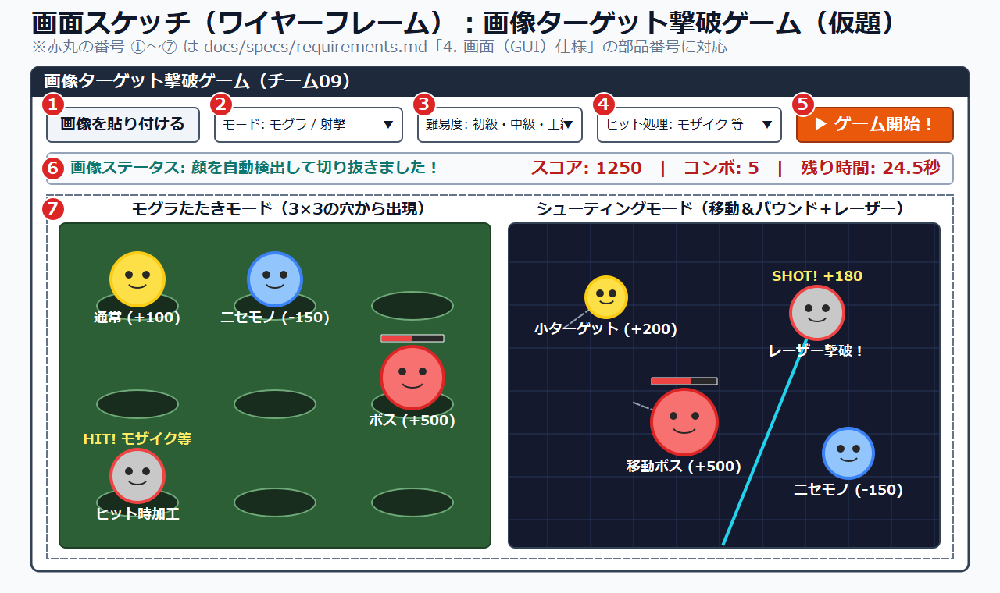

# 要求仕様書: 画像ターゲット撃破ゲーム（仮題）

- バージョン: v0.3
- チーム: チーム09（グループB）
- 最終更新日: 2026-11-19
- ステータス: 草案

## 1. 背景と目的
既存のモグラたたきゲームやシューティングゲームは、あらかじめ用意された固定キャラクターを叩く・撃つものが多く、プレイヤーが自分の好きな写真やイラストをそのままターゲットにして遊ぶことができない。
本アプリでは、ユーザーが選んだ任意の画像に対して **OpenCV 等による顔自動検出・切り抜き、ヒット時のリアルタイム画像処理エフェクト、色相変換によるニセモノ生成、強調加工によるボス（強敵）ターゲット生成** を適用し、「モグラたたきモード」「シューティングモード」の2モード ×「初級・中級・上級」の3難易度で楽しく遊べるオリジナルの画像処理応用ゲームを実現する。

## 2. ユーザーストーリー
- US-01: プレイヤーとして、自分のPCにある好きな写真やイラストを読み込んで、ゲームのターゲット（的）にしたい。なぜなら、自分だけのオリジナルキャラクターや友人の顔などを使って楽しく遊びたいから。
- US-02: プレイヤーとして、「モグラたたきモード（穴から出現）」と「シューティングモード（画面内を移動）」を切り替えて遊びたい。なぜなら、その時の気分に合わせて異なるゲーム性を楽しみたいから。
- US-03: プレイヤーとして、ターゲットを叩いた・撃ち抜いた瞬間に、ターゲット画像がモザイクや歪みなどの面白いダメージ画像に変化してほしい。なぜなら、ヒットした爽快感や画像処理ならではの面白さを味わいたいから。
- US-04: プレイヤーとして、撃ってはいけない「ニセモノ（減点ターゲット）」を見分けつつ、複数回攻撃して倒す「ボス（強敵）」を撃破して高スコアやコンボを狙いたい。なぜなら、戦略性と達成感のあるゲームとして盛り上がりたいから。
- US-05: プレイヤーとして、自分の腕前に合わせて「初級・中級・上級」の3段階から難易度を選びたい。なぜなら、初心者でも楽しめ、慣れたらやりごたえのあるスピードに挑戦したいから。

## 3. スコープ
### 対象
- ローカルPCからの画像ファイル（PNG / JPEG / BMP 等）の読み込み（日本語ファイルパス対応）
- 画像からの顔自動検出・切り抜き（顔が検出されない場合は中央を正方形に切り抜き）と円形マスク合成
- ヒット時のリアルタイム画像処理エフェクト（モザイク＋赤フラッシュ、膨張歪み、エッジ抽出など複数種類から選択可能）
- 貼り付けた画像からの特殊ターゲット自動生成：
  - **ニセモノ（減点ターゲット）**：HSV色相変換による青色系ターゲット
  - **ボス（強敵ターゲット）**：コントラスト・赤み強調加工＋オーラ枠付きの大型・複数HPターゲット
- 2つのゲームモード（「モグラたたきモード」「シューティングモード」）の切り替えとマウスクリックによる当たり判定
- 3段階の難易度選択（「初級」「中級」「上級」）による出現速度・移動速度・出現率の変化
- 制限時間内のスコア・コンボ計算および結果表示

### 対象外
- オンライン対戦・ネットワーク経由でのランキング共有
- 音声・BGM再生（優先度が低いため初期版では対象外。余裕があれば検討）
- クラウドAPIを用いた画像認識・生成
- スマートフォン・Webブラウザでの動作（Windows / macOS デスクトップアプリのみ対象）

## 4. 画面（GUI）仕様

| No | 部品 | 動作 |
|----|------|------|
| ① | 「画像を貼り付ける」ボタン | ファイル選択ダイアログを開き、選択した画像を読み込んで顔（または中央）を切り抜き、通常・ニセモノ・ボスの各ターゲット画像を生成・設定する |
| ② | モード切替プルダウン | 「モグラたたきモード」「シューティングモード」を切り替える。切り替え時にゲームを初期状態にリセットする |
| ③ | 難易度切替プルダウン | 「初級」「中級」「上級」の3段階から難易度を選択する |
| ④ | ヒット画像処理プルダウン | ヒット時に適用する画像処理エフェクト（「モザイク＋赤フラッシュ」「膨張歪み」「劇画エッジ化」）を選択する |
| ⑤ | 「ゲーム開始！」ボタン | スコア・コンボ・残り時間を初期化し、選択中のモード・難易度でゲームを開始する |
| ⑥ | ステータス・スコア表示バー | 画像読み込み結果（顔検出できたか等）、現在のスコア、コンボ数、残り時間をリアルタイム表示する |
| ⑦ | ゲームキャンバス | モグラたたきモードでは3×3の穴と出現ターゲット、シューティングモードでは移動するターゲットとレーザー演出を描画し、クリックで当たり判定（ボスのHPゲージ表示含む）を行う |

## 5. 入出力ファイル仕様
| 種類 | 形式 | 説明 |
|------|------|------|
| 入力 | PNG / JPEG / BMP / WEBP | ユーザーが選択するターゲット用画像（日本語ファイル名・フォルダパスにも対応） |
| 入力 | 画像フォルダ（テスト用） | `data/test_images/faces/` 等の受け入れテスト用画像群 |
| 出力 | なし（画面表示のみ） | ※ハイスコアをJSON/CSVファイルに保存するかは未決事項（UQ-003）で検討 |

## 6. 機能要求

### REQ-001: ターゲット画像の読み込みと顔自動切り抜き
- 説明: ユーザーが選択した画像ファイルを読み込み、顔を自動検出して顔周辺を正方形に切り抜き、円形マスクを適用したターゲット画像を生成する。顔が検出できない場合は画像中央を正方形に切り抜く。
- 対応US: US-01
- 受け入れ基準:
  - AC-001-1: PNG/JPEG形式の画像ファイルを選択したとき（日本語パスを含む）、システムはエラーなく画像を読み込み、指定サイズ（例: 130×130px）の円形ターゲット画像を生成しなければならない。
  - AC-001-2: `data/test_images/faces/` の正面顔画像10枚を入力したとき、8枚以上で顔領域を検出し、顔が中央に収まるように切り抜かなければならない。
  - AC-001-3: 顔が写っていない画像（イラスト・風景など）を入力したとき、システムはエラーで停止せず、画像中央を正方形に切り抜いてターゲット画像を生成しなければならない。
- 優先度: Must

### REQ-002: ヒット時ダメージ画像処理エフェクトの生成
- 説明: ターゲット画像に対し、選択されたエフェクト（モザイク＋赤フラッシュ、膨張歪み、劇画エッジ化）を画像処理で適用し、ヒット時に表示するダメージ画像を生成する。
- 対応US: US-03
- 受け入れ基準:
  - AC-002-1: 3種類のエフェクトそれぞれを選択して処理を実行したとき、システムは入力画像と同じ解像度で、元画像とは異なる加工済み画像を生成しなければならない。
  - AC-002-2: ターゲットにヒットしたとき、システムは一定時間（例: 0.4秒間）ダメージ画像と獲得スコアを画面に表示しなければならない。
- 優先度: Must

### REQ-003: ニセモノ（減点ターゲット）画像の自動生成と減点判定
- 説明: 元のターゲット画像をHSV色空間に変換し、色相をシフトさせて見た目に区別できる「青いニセモノ」画像を自動生成する。ニセモノを叩いた・撃った場合は減点し、コンボをリセットする。
- 対応US: US-04
- 受け入れ基準:
  - AC-003-1: ターゲット画像からニセモノ画像を生成したとき、HSV色相の平均値が元画像から変化しており、かつ元画像と同じ解像度でなければならない。
  - AC-003-2: ゲーム中にニセモノターゲットをクリックしたとき、システムはスコアを減点（下限0点）し、コンボ数を0にリセットしなければならない。
- 優先度: Must

### REQ-004: ボス（強敵ターゲット）画像の自動生成と複数回ヒット撃破
- 説明: 元のターゲット画像にコントラスト強調・赤黒オーラ加工などの画像処理を施した「ボスターゲット」を自動生成する。ボスは複数のHP（耐久値）を持ち、HPゲージを表示しながら複数回ヒットさせることで撃破でき、撃破時に高得点ボーナスを付与する。
- 対応US: US-04
- 受け入れ基準:
  - AC-004-1: ターゲット画像からボス画像を生成したとき、元画像とは画素値が異なる強調加工画像（通常ターゲットより大きいサイズまたは専用オーラ枠付き）が生成されなければならない。
  - AC-004-2: ボスターゲットをクリックしたとき、HPが1減少し、HPが1以上残っている間は消滅せず残りHPゲージが更新されなければならない。
  - AC-004-3: ボスターゲットのHPが0になったとき、システムは撃破と判定してダメージ画像を表示し、通常ターゲットより高い撃破ボーナス点（例: +500点以上）をスコアに加算しなければならない。
- 優先度: Must

### REQ-005: モグラたたきモードのゲーム進行と当たり判定
- 説明: 3×3の9つの穴からターゲット（通常・ニセモノ・ボス）がランダムに出現し、一定時間後に引っ込む。出現中にクリックするとヒット判定となり、スコアとコンボが加算される。
- 対応US: US-02, US-04
- 受け入れ基準:
  - AC-005-1: モグラたたきモードで「ゲーム開始！」を押したとき、制限時間のカウントダウンが開始され、9つの穴のいずれかからターゲットが出現しなければならない。
  - AC-005-2: 出現中の通常ターゲットの円内をクリックしたとき、システムはヒットと判定し、基本点＋コンボボーナスをスコアに加算しなければならない。
  - AC-005-3: 残り時間が0.0秒になったとき、システムはゲームを終了し、最終スコアを表示しなければならない。
- 優先度: Must

### REQ-006: シューティングモードのゲーム進行と当たり判定
- 説明: 大・中・小サイズの通常・ニセモノターゲットおよび大型ボスターゲットが画面内を移動（画面端でバウンド）し、クリックで撃ち抜く。小さいターゲットほど高いサイズボーナス得点を付与し、射撃時にレーザー演出を表示する。
- 対応US: US-02, US-04
- 受け入れ基準:
  - AC-006-1: シューティングモードで「ゲーム開始！」を押したとき、ターゲットが画面内を移動し、画面外に消えずに端で跳ね返らなければならない。
  - AC-006-2: 移動中の通常ターゲットの円内をクリックしたとき、サイズに応じたボーナス点（小＞中＞大）とコンボボーナスをスコアに加算しなければならない。
- 優先度: Must

### REQ-007: 難易度選択（初級・中級・上級）によるパラメータ切替
- 説明: プレイヤーが「初級」「中級」「上級」の3段階から難易度を選択でき、難易度に応じてターゲットの出現時間・移動速度・同時出現数・ニセモノ出現率・ボスHPなどのゲームパラメータを切り替える。
- 対応US: US-05
- 受け入れ基準:
  - AC-007-1: 難易度プルダウンから「初級」「中級」「上級」を選択したとき、各難易度に対応するパラメータセット（出現速度・移動速度・同時出現上限・ボスHPなど）が適用されなければならない。
  - AC-007-2: 「上級」のターゲット移動速度および出現頻度は「中級」より高く、「中級」は「初級」より高くなければならない（初級 ＜ 中級 ＜ 上級）。
- 優先度: Must

## 7. 非機能要求
### NFR-001: 処理速度（応答性）
- 説明: 画像の読み込み・顔検出・エフェクト生成やゲーム中の描画が快適に動作すること。
- 受け入れ基準:
  - NFR-001-1: 1280×720以下の画像1枚を読み込んで通常・ダメージ・ニセモノ・ボスの各ターゲット画像を生成する処理が、開発PC上で1.0秒以内に完了すること。
  - NFR-001-2: ゲームループは20FPS（50ms間隔）以上で動作し、クリックから画面反映まで体感できる遅延がないこと。

### NFR-002: 対応OS・テスト容易性
- 説明: チーム全員の開発環境（Windows / macOS）で同一コードが動作し、GUIなしでも画像処理・ゲームロジックの単体テストを実行できること。
- 受け入れ基準:
  - NFR-002-1: Windows と macOS の両方でアプリが起動し、全自動テストが成功すること。
  - NFR-002-2: 画像処理モジュールとゲームロジックモジュールは、GUI（PyQt5）を起動せずに `unittest` でテストできること。

## 8. 未決事項
| ID | 内容 | 選択肢 | 状態 |
|----|------|--------|------|
| UQ-001 | アプリの正式名称 | A: フェイスバスター / B: ピクチャーモグラ＆シューター / C: チームで別案を考える | 未決 |
| UQ-002 | 顔検出に使う手法 | A: OpenCV Haar Cascade（軽量・モデル同梱で配布が楽） / B: MediaPipe FaceDetector（精度が高いがモデルファイル管理が必要） | 未決 |
| UQ-003 | ハイスコアの保存機能を入れるか | A: JSONファイルにモード・難易度別のハイスコアを保存する / B: アプリ起動中のみ保持（ファイル保存なし） | 未決 |
| UQ-004 | Webカメラを使った操作（手の動きで叩く等）を入れるか | A: マウス操作のみに絞って完成度を上げる / B: カメラ操作モードを追加する | 未決 |
| UQ-005 | ボスの具体的なHP・出現タイミング | A: 難易度別にHP 3/4/5・ランダム出現 / B: 残り10秒で必ず1体出現するラストボス方式 | 未決 |

## 9. 決定事項
| ID | 決定内容 | 理由 | 日付 |
|----|----------|------|------|
| DEC-001 | ゲームモードを「モグラたたきモード」と「シューティングモード」の2種類に分ける | 両方の遊び方を切り替えられるようにしてゲーム性と独自性を高めるため | 2026-11-18 |
| DEC-002 | 敵に「通常」「ニセモノ」に加えて「ボス（強敵）」を追加する | 複数回ヒットで撃破する強敵と画像処理による強調演出を入れ、ゲーム性を高めるため | 2026-11-19 |
| DEC-003 | 難易度を「初級・中級・上級」の3段階に分ける | プレイヤーのレベルに合わせて遊べるようにし、やり込み要素を作るため | 2026-11-19 |

## 10. 変更履歴
| バージョン | 日付 | 変更内容 | レビュー者 |
|------------|------|----------|------------|
| v0.1 | 2026-11-17 | 初版（テンプレート配置） | |
| v0.2 | 2026-11-19 | ユーザーストーリー・スコープ・画面仕様・REQ/AC・非機能要求・未決事項の草案を作成 | |
| v0.3 | 2026-11-19 | ボス（強敵）ターゲット（REQ-004）と3段階難易度選択（REQ-007）を追加 | |
